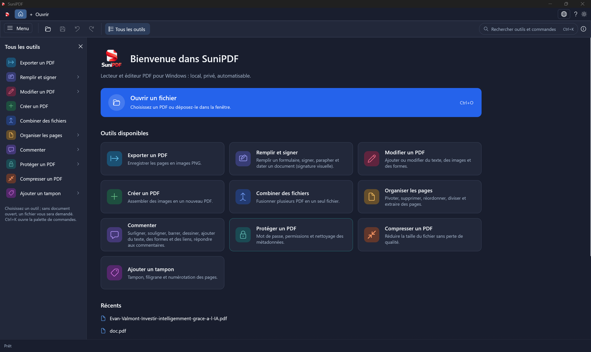
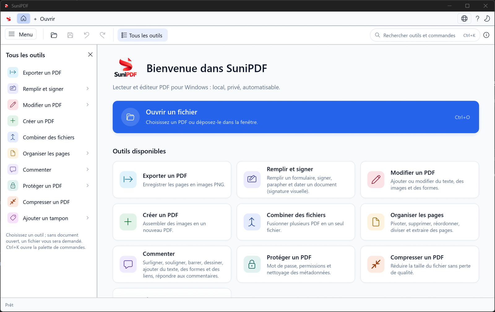
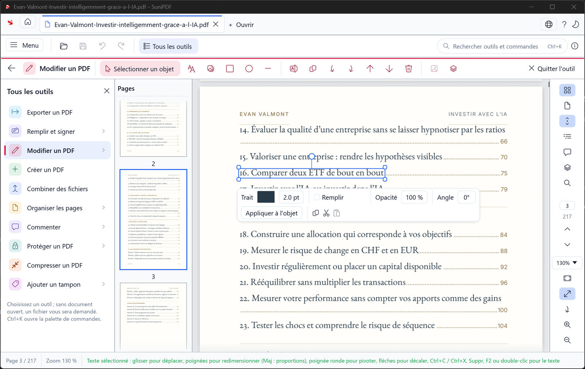
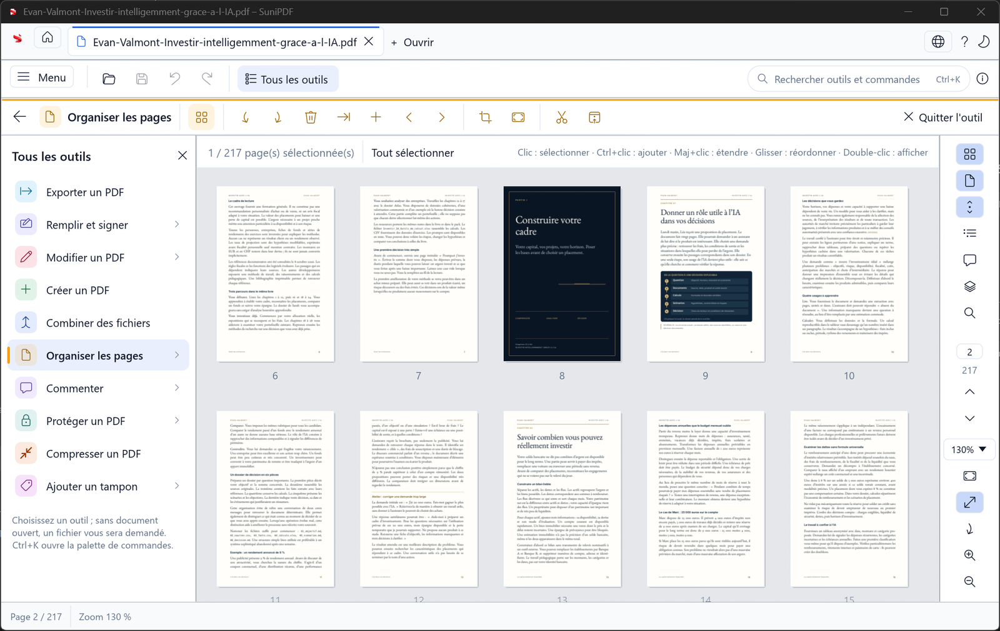
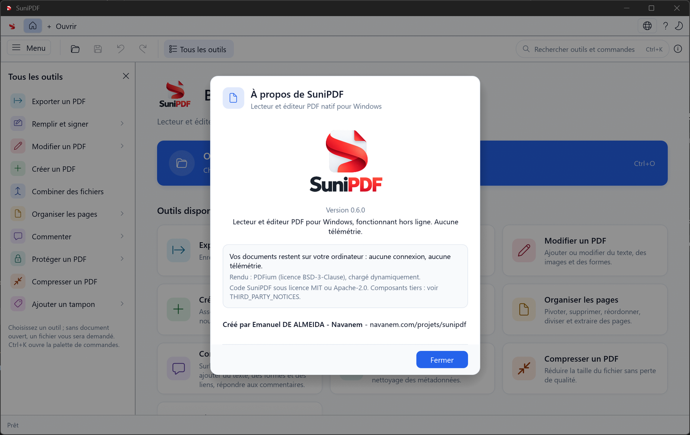

# SuniPDF

<p align="center">
  <picture>
    <source media="(prefers-color-scheme: dark)" srcset="assets/logo/sunipdf-wordmark-dark.png">
    
  </picture>
</p>

[English](README.md)

**Lecteur et éditeur PDF natif pour Windows 10/11, libre, traitement local, bilingue anglais / français.**

Créé par **Emanuel DE ALMEIDA** ([@lmdanavanem](https://github.com/lmdanavanem)) · [Navanem](https://navanem.com/projets/sunipdf/) ·
Licence MIT ou Apache-2.0, au choix.

[](https://github.com/lmdanavanem/SuniPDF/releases)
[](https://github.com/lmdanavanem/SuniPDF/actions/workflows/ci.yml)


## Pourquoi SuniPDF
- **Vos fichiers restent chez vous** : aucun PDF envoyé, aucun compte, aucune télémétrie, aucun traitement dans le cloud. La recherche de mises à jour contacte GitHub et peut être désactivée.
- **Natif** : Rust, interface egui, moteur PDFium ; ZIP portable ou MSI, avec OCR embarqué.
- **Complet** : lecture, annotation, édition du contenu, organisation des pages, formulaires, signature visuelle,
  tampons, conversions, protection, ligne de commande scriptable.
- **Honnête** : ce qui n'est pas fini reste dans la feuille de route (`docs/ROADMAP.fr.md`), jamais annoncé comme terminé.

## Fonctionnalités
| Domaine | Détail |
|---|---|
| Lire | Onglets, vues continue/page unique/double page/Livre, création/réinitialisation des étiquettes et page physique `#N`, destinations précises des liens/signets, rotation de vue, plein écran, historique de position/zoom, tuiles, recherche et sélection logique entre pages |
| Commenter | Surligner, souligner, barrer, notes, encre, texte libre, formes, liens, fils de réponses et panneau des commentaires |
| Modifier | Texte (polices standard et polices système incorporées), images, formes, sélection / déplacement / redimensionnement / rotation / opacité des objets existants, rotation/redimensionnement groupés, copier-coller entre pages et onglets, panneau Objets, recadrage souris et redimensionnement des pages |
| Organiser | Pivoter, supprimer, insérer, réordonner, combiner, diviser, extraire, pages vierges ; extraction/division conservent chiffrement, mots de passe et permissions |
| Remplir et signer | AcroForm, texte libre des listes modifiables, exports radio `/Opt`, brouillons conservés/relance après erreur de lecture, Appliquer/Abandonner groupés, clavier, aplatissement, export JSON/XFDF et import JSON/XFDF/FDF de valeurs ; signatures visuelles/paraphes dessinés, saisis ou importés, pose atomique sur toutes les pages/la sélection, date |
| Créer des formulaires | Champs texte, cases, groupes radio, listes déroulantes ordinaires/modifiables et zones de liste simples/multiples nommés par rectangles numériques, documents pivotés/recadrés/protégés, annulation et remplissage/enregistrement |
| Récupérer | Instantanés automatiques toutes les 60 secondes et à la suspension ; source intacte, chiffrement PDF conservé, aucun mot de passe stocké, restauration Enregistrer sous |
| Imprimer | Sélection native Windows, plages/copies/orientation, modifications courantes, rendu tramé borné, progression et annulation |
| Tampons | Filigrane texte (angle, opacité, position), numérotation des pages |
| Convertir | Images → PDF, PDF → PNG, optimisation sans perte, compression des images avec perte vers une nouvelle copie ; OCR anglais/français embarqué hors ligne, texte invisible recherchable, pages textuelles ignorées, annulation et undo ; lots séquentiels compression/OCR |
| Protéger | Chiffrement AES-128 / AES-256 avec permissions, retrait de la protection, nettoyage des métadonnées, propriétés et caviardage irréversible |
| Certificats | Intégrité des octets enregistrés, copie signée PFX/P12 incrémentale ; confiance/révocation/horodatage fiable non établis ; signature de PDF chiffré refusée |
| Automatiser | `sunipdf-cli` : 52 commandes JSON et codes stables, dont `set-page-labels`, `reset-page-labels`, `compress-images`, `add-form-field`, `ocr`, `signatures` et `sign` |

Les 14 outils possèdent de vraies commandes. La sélection suit l'ordre logique PDFium, sans reconstruire des colonnes
arbitraires non balisées. Impression réelle, matériel ARM64 et interopérabilité des signatures restent des contrôles QA distincts.

Détail fait / planifié : `docs/FEATURE_MATRIX.fr.md`, `docs/PROJECT_STATUS.fr.md`, `docs/ROADMAP.fr.md` ; nouveautés : `CHANGELOG.fr.md`.

**[0.14.0 publiée en Latest](https://github.com/lmdanavanem/SuniPDF/releases/tag/v0.14.0)** sous `lmdanavanem`.
420 tests du workspace, formatage/Clippy, 890 clés EN/FR, 63 contrôles qpdf et quatre documents NIST/NBS licenciés
(744 pages ; 53,91 s localement) réussis, ainsi que CI Windows finale, compilation ARM64, douze scénarios portables et six
bases de mise à niveau MSI. Six fichiers préparés/publics et contrôles renforcés des binaires réussis ; copies
vérifiées dans `dist/`. Le metteur à jour de production a vérifié le ZIP Latest x64 de 19 785 200 octets sans installation.
Source, preuves et limites dans l'[état du projet](docs/PROJECT_STATUS.fr.md).

Nouveautés **0.14.0** : créer des étiquettes de navigation sur une plage physique ou les réinitialiser
toutes, depuis Pages/Organiser et deux commandes CLI. Styles décimal, romain, lettres et préfixe seul ; étiquettes
hors plage conservées. Annuler/Rétablir préserve la navigation si la géométrie des pages est inchangée. Les signatures
visuelles saisies et multipages restent disponibles depuis 0.13.0 ; voir la [roadmap](docs/ROADMAP.fr.md).

## Captures d'écran
| Accueil (thème sombre) | Accueil (thème clair) |
|---|---|
|  |  |

| Modifier un PDF : sélection et style d'un objet | Organiser les pages : grille de miniatures |
|---|---|
|  |  |

<p align="center"></p>

## Installation
Page [Releases](https://github.com/lmdanavanem/SuniPDF/releases) : **MSI x64** (installation classique) ou
**ZIP portable x64** (décompresser, lancer `sunipdf.exe`), avec empreintes SHA256. Un ZIP ARM64 est compilé en
intégration continue mais n'a pas encore été exécuté sur du matériel ARM64. Aucun redistribuable Visual C++ n'est requis.
L'OCR inclut Tesseract 5.5.3, Leptonica 1.87.0 et les modèles rapides anglais/français figés ; gardez le dossier
`licenses/` avec l'application. Aucun modèle n'est téléchargé pendant la reconnaissance et aucun PDF n'est envoyé.

Depuis la 0.8.2, une notification au démarrage permet de télécharger la mise à jour, puis de fermer et installer
après confirmation. Le MSI met à jour une installation x64 ; les portables remplacent leur dossier avec une sauvegarde.
La recherche automatique se désactive dans À propos ; les versions antérieures demandent une première mise à niveau manuelle.

Guides : [`docs/USER_GUIDE.fr.md`](docs/USER_GUIDE.fr.md) · [`docs/USER_GUIDE.en.md`](docs/USER_GUIDE.en.md).

## Compiler
Prérequis : [Rust stable](https://rustup.rs), **Build Tools pour Visual Studio** (charge « Développement Desktop en C++ »)
et **CMake** dans PATH. La première préparation OCR compile les sources natives figées après contrôle SHA256.
```powershell
git clone https://github.com/lmdanavanem/SuniPDF.git
cd SuniPDF
.\scripts\fetch-pdfium.ps1              # binaires PDFium (bblanchon/pdfium-binaries), empreinte vérifiée
.\scripts\fetch-ocr.ps1 -Arch x64      # moteur OCR et modèles locaux, sources et empreintes figées
cargo test --workspace -j 2              # moteur, interface, CLI, i18n
cargo run -p sunipdf-desktop -j 2 -- fichier.pdf
cargo run -p sunipdf-cli -j 2 -- info fichier.pdf
.\scripts\package-portable.ps1 -Arch x64 # ZIP portable + SHA256
.\scripts\package-msi.ps1 -Arch x64      # MSI (WiX 3.14, téléchargé automatiquement)
```
Notes d'ingénierie (patrons de code, pièges, vérification visuelle) : `docs/ENGINEERING_NOTES.fr.md`.
Contribuer : `CONTRIBUTING.md` · Sécurité : `SECURITY.md`.

## Structure
```
apps/sunipdf-desktop   application (egui/eframe)      crates/sunipdf-core   moteur (PDFium, lopdf)
apps/sunipdf-cli       CLI JSON                       crates/sunipdf-i18n   traductions fr-FR / en-US
assets/i18n            catalogues                     docs/                 architecture, guides, décisions
packaging/wix          installateur MSI               scripts/              outils PowerShell / Python
```

## Licence et remerciements
Code SuniPDF : [MIT](LICENSE-MIT) ou [Apache-2.0](LICENSE-APACHE), au choix. Composants tiers et leurs licences :
`docs/THIRD_PARTY_NOTICES.fr.md`. SuniPDF s'appuie sur [PDFium](https://pdfium.googlesource.com/pdfium/) via
[pdfium-render](https://github.com/ajrcarey/pdfium-render), [lopdf](https://github.com/J-F-Liu/lopdf),
[egui / eframe](https://github.com/emilk/egui) et les polices système Segoe UI. SuniPDF n'est affilié ni à Adobe,
ni à Google ou Foxit (PDFium).
L'OCR utilise [Tesseract](https://github.com/tesseract-ocr/tesseract) (Apache-2.0),
[Leptonica](https://github.com/DanBloomberg/leptonica) (BSD-2-Clause) et les modèles anglais/français
[tessdata_fast](https://github.com/tesseract-ocr/tessdata_fast) (Apache-2.0). Licences, auteurs, inventaire
des copyrights et notice de compilation sont livrés dans `licenses/`.
